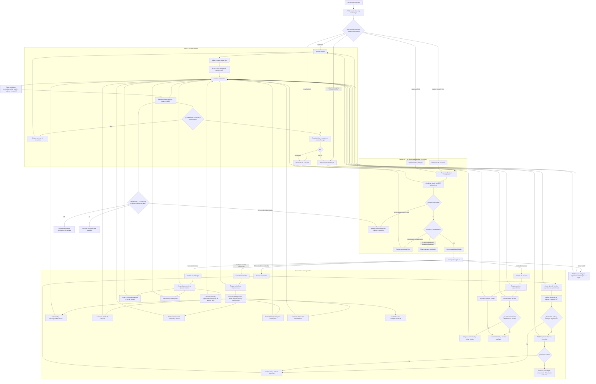

# Diagrama de flujo actual

El diagrama representa las entradas activas del frontend React, los controles de sesión y rol, las funciones principales de cada pantalla y el servicio común de API. El backend se ejecuta por separado en `http://localhost:3000`; sus procesos internos no están representados aquí.

## Alcance

- Las cinco páginas HTML indicadas son las entradas configuradas en Vite y comparten el montaje React.
- Los permisos y redirecciones descritos corresponden a los controles del frontend; la validación definitiva de permisos depende también del backend.
- Los scripts de `legacy/js/` se conservan para compatibilidad/pruebas, pero las entradas HTML actuales cargan `src/main.jsx`.
